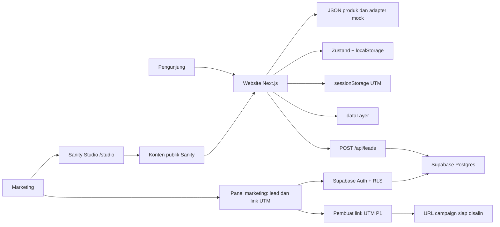

# PRD Kodeva — Campaign, Blog, dan Mini Marketplace

Versi: 1.7  
Tanggal dibuat: 12 Oktober 2026, Asia/Jakarta  
Terakhir diperbarui: 14 Oktober 2026, Asia/Jakarta  
Status: implementasi lokal tersedia; koneksi cloud, Lighthouse, dan deploy belum diverifikasi.  
Keputusan pengguna: menggunakan Next.js, memakai prototype Kodeva Akhir Tahun dari Google AI Studio sebagai arah visual, dan memasukkan fitur pembeda yang direkomendasikan ke PRD. Implementasi mengikuti gaya tersebut dengan copy Bahasa Indonesia yang khusus untuk demo ini. Pembuat link UTM, filter/ekspor lead, serta test logika inti sudah dibuat; preview draft dan tabel paket masih ditunda. Repository lokal ada di `kodeva-app`; CMS Sanity dan Supabase dipasang, tetapi environment cloud lokal belum diisi. PRD ini mencatat kebutuhan awal dan status aktual, bukan bukti bahwa layanan online sudah siap.

## 1. Konteks dan tujuan

### 1.1 Status implementasi lokal — 14 Oktober 2026

| Bagian                                                                                         | Status aktual                                                                                                                                                                                                       |
| ---------------------------------------------------------------------------------------------- | ------------------------------------------------------------------------------------------------------------------------------------------------------------------------------------------------------------------- |
| Landing responsif, katalog enam produk, filter/search/sort URL, detail dan tiga paket          | Sudah dibuat dengan data demo; harga dan paket bukan penawaran nyata.                                                                                                                                               |
| Cart tersimpan, kuota lintas paket, ringkasan harga, checkout hasil tetap berhasil/gagal       | Sudah dibuat; order hanya mock pada browser, tanpa pembayaran atau penyimpanan transaksi.                                                                                                                           |
| Sanity Studio, skema campaign/blog, gambar dan artikel portable text, fallback, revalidasi tag | Kode sudah dibuat; login/dataset publish dan webhook perlu diverifikasi pada project cloud.                                                                                                                         |
| Lead dan panel marketing                                                                       | Endpoint, form, filter ID campaign/source, CSV dan allowlist RLS sudah dibuat. Lead insert dan login panel perlu kredensial lokal serta user marketing.                                                             |
| First-touch UTM, link builder Instagram/TikTok, event `dataLayer`                              | Sudah dibuat dan diuji pada fungsi murni; GA4 sungguhan tidak dipasang.                                                                                                                                             |
| Unit test logika                                                                               | 16 test pada 7 file telah lolos; uji browser/cloud belum dilakukan.                                                                                                                                                 |
| Build produksi                                                                                 | `pnpm build` lolos; landing, katalog, dan blog menerima HTTP 200 saat dijalankan lokal tanpa kredensial cloud. Uji route admin dengan user nyata belum dilakukan.                                                   |
| Verifikasi lokal                                                                               | Formatter, typecheck, lint, 16 unit test pada 7 file, peer dependency, dan build produksi lolos. Smoke flow tambah paket → cart → checkout sukses serta tampilan mobile sudah diperiksa manual.                     |
| Lighthouse mobile, URL deploy, akses reviewer                                                  | Lighthouse CLI belum dapat membuka debugging port Chrome; skor target 80 belum diverifikasi. Deploy dan akses reviewer masih perlu disiapkan. Durasi aktual pengerjaan perlu dicatat dari catatan waktu sebenarnya. |

Fitur preview draft Sanity dan tabel perbandingan paket sengaja belum dibuat. Koneksi cloud tidak disimulasikan sebagai berhasil ketika kunci belum tersedia.

Kodeva adalah brand fiktif software bisnis berlangganan untuk UMKM. Campaign “Promo Akhir Tahun” membutuhkan landing page dan blog yang dapat dikelola marketing, serta marketplace dengan alur belanja sampai pembayaran simulasi.

Sumber requirement: Fullstack_Developer_Skill_Test_DSG.pdf dari PT Digital Solusi Grup, lima halaman. Dokumen tes menjadi acuan kebutuhan dan penilaian; instruksi pengumpulan di dalamnya dicatat sebagai pekerjaan calon peserta, bukan tindakan yang sudah dilakukan.

Target hasil:

- Marketing dapat mengubah seluruh konten section landing dan mengelola artikel melalui CMS.
- Perubahan konten terpublikasi tampil tanpa deploy manual.
- Pengunjung dapat mengisi lead; marketing dapat membaca data yang tersimpan.
- Pengunjung dapat memilih produk/paket, mengelola keranjang, dan menjalankan checkout simulasi sukses/gagal.
- Kuota promo, harga, tracking, dan atribusi UTM bekerja sesuai aksi pengguna.
- Landing mencapai Lighthouse mobile Performance minimal 80.
- Reviewer memperoleh repository, deploy, akses CMS/admin demo, README, dan AI_LOG.

Batas waktu: pengumpulan dua hari kalender sejak brief diterima; anggaran kerja 6–8 jam. Tanggal deadline aktual dihitung dari waktu penerimaan brief, bukan tanggal PRD. Waktu aktual wajib dicatat.

## 2. Prioritas dan batas scope

| Label                  | Makna                                                                                                            |
| ---------------------- | ---------------------------------------------------------------------------------------------------------------- |
| Wajib brief            | Requirement eksplisit yang harus dikerjakan sebelum bonus.                                                       |
| Keputusan implementasi | Cara teknis memenuhi requirement; bukan tambahan kewajiban dari DSG.                                             |
| Interpretasi marketing | Respons terhadap kebutuhan SEO, berbagi tautan, dan ekspansi yang belum dirinci dalam requirement formal.        |
| Inisiatif tambahan     | Fitur pembeda yang disetujui masuk PRD; dikerjakan setelah requirement wajib, sesuai prioritas dan sisa timebox. |
| Bonus                  | Dikerjakan hanya setelah requirement wajib berjalan dan terverifikasi.                                           |
| Rencana lanjutan       | Desain tertulis untuk pengembangan setelah tes; tidak dibangun dalam MVP.                                        |

Scope wajib: landing, CMS, lead capture, blog, katalog/detail, keranjang persisten, kuota lintas paket, checkout simulasi, keadaan loading/error/kosong, mobile, tracking, UTM, deploy, dan dokumentasi.

Scope di luar MVP: payment gateway sungguhan, backend transaksi marketplace, pengiriman lisensi sungguhan, akun pelanggan, manajemen langganan, order management produksi, pajak kompleks, simulator kasir POS terpisah, penjualan perangkat fisik, layanan onboarding berbayar, dan website penuh untuk tiga negara. Voucher adalah bonus brief; kupon hanya dibuat jika fitur wajib sudah selesai dan aturan potongannya dapat dihitung serta dijelaskan dengan benar.

Bonus dari brief: pengaturan layout/urutan section, pencarian/sort/filter katalog dalam URL, durasi bulanan/tahunan, tabel fitur paket, penjadwalan promo, voucher, preview draft, serta test otomatis logika penting. Test otomatis kecil dipilih sebagai dukungan kualitas bila jalur wajib sudah selesai; keberadaannya tidak menutupi fitur wajib yang belum berjalan.

### 2.1 Paket fitur pembeda

| Prioritas | Fitur                                                | Asal scope                                                                     | Status aktual                                                                                   |
| --------- | ---------------------------------------------------- | ------------------------------------------------------------------------------ | ----------------------------------------------------------------------------------------------- |
| P1        | Pembuat link campaign UTM                            | Inisiatif tambahan untuk pekerjaan marketing                                   | Implementasi lokal tersedia; pure function diuji, clipboard perlu dicoba pada browser.          |
| P1        | Test otomatis kuota, harga, dan UTM                  | Test logika termasuk bonus brief; kasus UTM dipilih untuk membuktikan atribusi | 16 test pada 7 file lolos; storage browser, login/RLS, dan alur lintas halaman belum diuji E2E. |
| P2        | Filter lead berdasarkan campaign/sumber + ekspor CSV | Inisiatif tambahan untuk tindak lanjut lead                                    | Filter URL/query, ekspor 500 baris dan CSV injection guard dibuat; perlu uji dengan lead cloud. |
| P3        | Preview draft sebelum publish                        | Bonus brief                                                                    | Belum dibuat.                                                                                   |
| P3        | Tabel perbandingan Basic/Pro/Business                | Bonus brief                                                                    | Belum dibuat.                                                                                   |

Estimasi awal adalah acuan scope, bukan catatan durasi aktual. README mencatat hasil build dan hal yang belum bisa diverifikasi dari lingkungan lokal.

## 3. Pengguna dan alur utama

| Pengguna                         | Kebutuhan                                     | Alur utama                                                              |
| -------------------------------- | --------------------------------------------- | ----------------------------------------------------------------------- |
| Pengunjung dari Instagram/TikTok | Memahami promo dan membeli software           | Link ber-UTM → landing → CTA → katalog → detail → keranjang → checkout. |
| Pemilik UMKM dari pencarian      | Membaca artikel dan menemukan produk relevan  | Blog → artikel → tautan produk → detail → checkout.                     |
| Marketing                        | Mengubah konten tanpa coding dan melihat lead | Login CMS → edit → publish; login panel lead → membaca daftar lead.     |
| Reviewer                         | Mencoba fungsi dan menilai keputusan teknis   | Website publik, CMS/admin demo, skenario uji, dan dokumentasi.          |

Alur lead: landing ber-UTM → berpindah halaman → kembali ke form → isi nama dan kontak → validasi → tersimpan → terlihat di panel marketing dengan UTM asal.

Alur tambahan marketing: login panel marketing → buat link Instagram/TikTok → salin dan gunakan link campaign → lihat lead dari campaign tersebut → filter dan ekspor bila fitur P2 tersedia. Preview draft dilakukan melalui Studio jika fitur P3 dipilih.

## 4. Teknologi dan library

### 4.1 Stack utama

| Area                    | Teknologi/library                           | Keputusan pemakaian                                                                                                                                                                                        |
| ----------------------- | ------------------------------------------- | ---------------------------------------------------------------------------------------------------------------------------------------------------------------------------------------------------------- |
| Runtime                 | Node.js 24 LTS                              | Satu versi untuk lokal dan hosting. Pin patch pada `.nvmrc` ketika bootstrap. [Rilis Node.js](https://nodejs.org/en/about/previous-releases).                                                              |
| Framework               | Next.js 16.x, App Router                    | Routing, Server Components, metadata, image/font optimization, dan Route Handler untuk lead. Pilih patch stabil saat setup. [Instalasi Next.js](https://nextjs.org/docs/app/getting-started/installation). |
| UI runtime              | `react`, `react-dom`                        | Versi kompatibel dengan Next.js terpilih; diverifikasi melalui peer dependencies, bukan dipilih terpisah.                                                                                                  |
| Bahasa                  | TypeScript, `strict: true`                  | Semua kode aplikasi, CMS schema, helper, dan test yang ditulis menggunakan `.ts`/`.tsx`. JSON dan SQL adalah format data/migrasi.                                                                          |
| Package manager         | pnpm                                        | Satu package manager; commit `pnpm-lock.yaml`, pin versi melalui `packageManager`. [Instalasi pnpm](https://pnpm.io/installation).                                                                         |
| Styling                 | CSS responsif dan custom properties         | Token warna, grid, breakpoint, reduced motion, serta komponen disusun langsung di `src/app/globals.css`; Tailwind/shadcn tidak dipasang karena implementasi visual memakai CSS biasa.                      |
| Komponen UI             | Primitive lokal: `Button`, `Field`, `Badge` | API reusable berada di repository; komponen domain seperti `ProductCard` dan ringkasan order tetap bersama feature. Tidak menambah Radix untuk elemen yang saat ini memakai HTML native.                   |
| Ikon                    | `lucide-react`                              | Import ikon individual untuk navigasi, keranjang, status, dan form. [Dokumentasi Lucide](https://lucide.dev/guide/react).                                                                                  |
| State keranjang         | `zustand` + middleware `persist`            | Aksi keranjang terpusat, persistensi localStorage, dan penanganan hidrasi. [Dokumentasi persist](https://zustand.docs.pmnd.rs/reference/middlewares/persist.html).                                         |
| Form dan validasi       | HTML form native + `zod` 4                  | Form memakai FormData browser dan schema Zod pada batas input. React Hook Form/resolver tidak dipasang karena state form MVP tidak membutuhkannya.                                                         |
| Validasi                | `zod` 4                                     | Validasi input, fixture produk, storage keranjang, dan payload mock. Schema lead yang sama dipakai client/server. [Dokumentasi Zod](https://zod.dev/).                                                     |
| CMS                     | Sanity Content Lake + `sanity` 5.31         | Konten marketing dan blog; Studio embedded di `/studio`. [Embedding Studio](https://www.sanity.io/docs/nextjs/embedding-sanity-studio-in-nextjs).                                                          |
| Integrasi CMS           | `next-sanity`                               | Client GROQ, query typed, dan integrasi Next.js. Gunakan strategi cache manual sederhana. [Konfigurasi client](https://www.sanity.io/docs/nextjs/configure-sanity-client-nextjs).                          |
| Gambar CMS              | `@sanity/image-url` + `next/image`          | URL transform gambar Sanity dan rendering responsif. [Toolkit resmi](https://www.sanity.io/plugins/next-sanity).                                                                                           |
| Rich text               | `@portabletext/react`                       | Render isi artikel, gambar, heading, dan tautan produk. [Repository resmi](https://github.com/portabletext/react-portabletext).                                                                            |
| Lead dan auth marketing | Supabase Postgres + Supabase Auth           | Lead terpusat; akses membaca lewat akun marketing. Supabase hanya melayani lead/admin, bukan transaksi marketplace.                                                                                        |
| Client database/auth    | `@supabase/supabase-js`, `@supabase/ssr`    | Route Handler lead, session berbasis cookie, dan pembacaan admin dengan RLS. [Panduan SSR](https://supabase.com/docs/guides/auth/server-side/nextjs).                                                      |
| Hosting                 | Vercel Hobby                                | Deploy personal untuk evaluasi, memakai subdomain bawaan dan environment variables. Hobby ditujukan untuk penggunaan personal nonkomersial. [Ketentuan paket](https://vercel.com/docs/plans/hobby).        |

Implementasi lokal mengunci Next.js 16.4.0, React 19.3.0, Node.js 24, Sanity 5.31.2, next-sanity 13.3.4, Supabase JS 2.117.3, Zod 4.6.7, Vitest 5.0.4, Prettier 3.9.10, dan pnpm 11.25.0 pada manifest/lockfile. Peer dependencies sudah diperiksa tanpa isu. Versi yang dipasang tidak berarti interaksi cloud sudah diuji.

### 4.2 Komponen UI yang dipilih

Komponen bersama dibuat berdasarkan pemakaian nyata dan kontrak perilaku yang sama, bukan karena elemen HTML-nya umum. MVP memakai `Button`, `Field` (label, control, hint, error), dan `Badge` sebagai primitive. `Card` generik belum diperlukan; FAQ memakai elemen `details` native.

Primitive lokal menjadi komponen yang dirawat di repository. `Button`, `Field`, dan `Badge` memiliki kontrak reusable, sementara `ProductCard`, cart line, ringkasan harga, dan tabel lead tetap memiliki konteks feature. Tabel memakai markup semantik dan perilaku sesuai kebutuhan; tidak ada wrapper tabel generik.

`clsx` menggabungkan class dan `class-variance-authority` mengatur varian Button. Styling memakai CSS custom properties. Tidak ada dependency Tailwind, Radix, atau katalog komponen yang tidak digunakan.

### 4.3 Tool pengembangan dan verifikasi

| Tool                          | Pemakaian                                                                                                                                                                                                                   |
| ----------------------------- | --------------------------------------------------------------------------------------------------------------------------------------------------------------------------------------------------------------------------- |
| ESLint + `eslint-config-next` | Lint TypeScript/React/Next.js; dijalankan langsung melalui script ESLint.                                                                                                                                                   |
| Prettier 3.9.10               | `pnpm format` dan `pnpm format:check`. [Panduan instalasi](https://prettier.io/docs/install).                                                                                                                               |
| TypeScript compiler           | `tsc --noEmit` untuk type checking.                                                                                                                                                                                         |
| Vitest 5.0.4                  | 16 test pada 7 file untuk kuota/harga, checkout mock canonical, katalog, first-touch, link UTM, kontak, dan CSV. Belum menguji storage/browser, login/RLS, atau clipboard secara E2E. [Panduan](https://vitest.dev/guide/). |
| Lighthouse di Chrome DevTools | Bukti skor mobile landing produksi; screenshot dan kondisi pengukuran disimpan.                                                                                                                                             |
| Playwright, opsional          | Smoke test alur belanja/UTM jika semua requirement wajib selesai. Tidak masuk dependency baseline. [Panduan](https://playwright.dev/docs/intro).                                                                            |

HTTP memakai native `fetch`; uang/tanggal memakai `Intl`; ID mock memakai `crypto.randomUUID`. Tidak perlu Axios, Redux, TanStack Query, ORM, library payment, ataupun library animasi besar untuk scope ini.

### 4.4 Alasan penyimpanan lead terpisah

Sanity Free menyediakan dataset publik dan dua role, Administrator/Viewer. Private dataset dan role Editor tersedia pada paket berbayar. Karena itu, konten publik berada di Sanity; lead berada di Supabase dengan RLS. [Paket Sanity](https://www.sanity.io/pricing).

Supabase Free menyediakan Postgres dan Auth, tetapi project dapat dipause setelah satu minggu tidak aktif. Catat batas ini dan periksa status project sebelum evaluasi. [Paket Supabase](https://supabase.com/pricing).

### 4.5 Teknologi fitur pembeda

| Fitur            | Pemakaian teknologi                                                                                                                                                                                                                                                                    |
| ---------------- | -------------------------------------------------------------------------------------------------------------------------------------------------------------------------------------------------------------------------------------------------------------------------------------- |
| Pembuat link UTM | HTML form native + Zod, `URL`/`URLSearchParams`, dan Clipboard API dengan fallback salin manual. Tidak menambah library URL/clipboard.                                                                                                                                                 |
| Test logika P1   | Vitest menguji fungsi cart, checkout, attribution, URL builder, kontak, filter katalog, dan CSV; browser persistence belum masuk suite.                                                                                                                                                |
| Filter/CSV P2    | Client Supabase ber-session + RLS, native query parameters, Route Handler CSV, dan serializer TypeScript kecil. Tidak menambah ORM/CSV framework.                                                                                                                                      |
| Preview draft P3 | `sanity/presentation`, `next-sanity/draft-mode`, Next.js Draft Mode, dan token Viewer server-only. Preview awal dapat direfresh manual; live-as-you-type bukan acceptance minimum. [Panduan Sanity](https://www.sanity.io/docs/visual-editing/visual-editing-with-next-js-app-router). |
| Tabel paket P3   | Komponen `PlanComparison` milik feature katalog + data fitur paket canonical; tanpa library perbandingan tambahan atau tabel generik.                                                                                                                                                  |

Semua fitur admin tambahan memakai auth marketing yang sudah dirancang, kecuali preview yang memakai handshake Studio. Library tambahan dipasang hanya jika fitur terkait benar-benar diimplementasikan.

## 5. Arsitektur



Satu repository dan satu deploy Next.js. Sanity dan Supabase adalah layanan eksternal terpisah.

- Halaman konten dan teks detail produk dirender server agar HTML dapat dibaca crawler.
- Interaksi paket, keranjang, form, atribusi, dan tracking menjadi Client Components.
- Studio, panel admin, dan layout publik dipisahkan; bundle CMS tidak dimuat pada landing.
- Root layout tidak membaca cookie admin. Pembacaan session hanya pada area admin agar tidak membuat seluruh website menjadi dinamis.
- Route Handler baseline untuk lead; fitur P2 dapat menambah ekspor CSV dan P3 menambah endpoint Draft Mode. Checkout/order tetap simulasi frontend.
- Adapter produk memakai fixture JSON yang sama untuk rendering server dan interaksi mock; menghindari dua sumber harga berbeda.

## 6. Halaman dan navigasi

| Route                         | Isi                                                       | Akses                                             |
| ----------------------------- | --------------------------------------------------------- | ------------------------------------------------- |
| `/`                           | Landing campaign dan lead form                            | Publik                                            |
| `/blog?page=1`                | Daftar artikel, pagination                                | Publik                                            |
| `/blog/[slug]`                | Detail artikel dan tautan produk                          | Publik, published saja                            |
| `/products`                   | Katalog dan filter kategori                               | Publik                                            |
| `/products/[slug]`            | Detail, galeri, paket, harga, kuota                       | Publik                                            |
| `/cart`                       | Keranjang penuh dan ringkasan                             | Publik                                            |
| `/checkout`                   | Form pembeli, review, simulasi pembayaran                 | Publik, keranjang valid                           |
| `/checkout/result/[orderId]`  | Hasil sukses/gagal order mock                             | Berdasarkan snapshot sesi browser                 |
| `/studio/[[...tool]]`         | CMS marketing dan blog                                    | Login Sanity                                      |
| `/admin/login`                | Login marketing untuk lead                                | Publik, noindex                                   |
| `/admin/leads`                | Daftar lead dan sumber campaign                           | Login marketing berizin, noindex                  |
| `/admin/campaign-links`       | Pembuat link UTM, paket P1                                | Login marketing berizin, noindex                  |
| `POST /api/leads`             | Validasi dan penyimpanan lead                             | Publik, input dibatasi                            |
| `GET /api/admin/leads/export` | CSV sesuai filter, hanya jika P2 dipilih                  | Login marketing berizin, respons private/no-store |
| `GET /api/draft-mode/enable`  | Handshake preview Studio, hanya jika P3 dipilih           | Request preview terverifikasi                     |
| `GET /api/draft-mode/disable` | Keluar preview ke konten published, hanya jika P3 dipilih | Menghapus mode draft sesi saat ini                |
| `/sitemap.xml`, `/robots.txt` | Dukungan indeks halaman publik                            | Publik                                            |

Header publik menyediakan Landing, Produk, Blog, dan Keranjang dengan badge jumlah lisensi. Keranjang dapat dibuka dari semua halaman publik, termasuk blog. Link admin tidak menjadi CTA utama pengunjung.

## 7. CMS dan model konten

### 7.1 `campaignLanding` sebagai singleton

| Field                                                                                 | Kebutuhan                                                                                                       |
| ------------------------------------------------------------------------------------- | --------------------------------------------------------------------------------------------------------------- |
| `campaignId`, `campaignName`                                                          | Identitas stabil untuk tracking; nama campaign dapat diedit.                                                    |
| `locale`, `market`, `currency`                                                        | Default `id-ID`, `ID`, `IDR`; metadata kesiapan ekspansi.                                                       |
| `hero.title`, `subtitle`, `image`, `imageAlt`                                         | Semua konten hero editable.                                                                                     |
| `hero.ctaLabel`, `ctaDestination`                                                     | Label editable; tujuan dibatasi ke katalog/internal path yang valid.                                            |
| `featured.title`, `description`, `items[]`                                            | Judul/deskripsi section dan daftar kartu editable.                                                              |
| `featured.items[].productId`, `title`, `description`, `image`, `imageAlt`, `ctaLabel` | Marketing dapat memilih produk serta mengubah seluruh konten kartu; detail transaksi tetap dari JSON produk.    |
| `testimonials.title`, `items[]`                                                       | Kutipan, jenis usaha, atribusi yang disetujui, foto opsional, dan penanda konten contoh. Nama tidak diwajibkan. |
| `faq.title`, `items[]`                                                                | Pertanyaan dan jawaban editable.                                                                                |
| `lead.title`, `description`, `buttonLabel`, `successMessage`                          | Copy form editable; aturan validasi tetap di kode.                                                              |
| `seo.title`, `description`, `ogImage`                                                 | Metadata campaign.                                                                                              |

Layout dan urutan section tetap di kode. Landing tidak menampilkan harga transaksi yang dapat diedit terpisah dari harga JSON. Produk unggulan memakai ID yang sama dengan marketplace; pilihan ID dalam Studio berasal dari fixture produk.

### 7.2 Artikel dan kategori

`post`: title, slug, cover image + alt, excerpt, body Portable Text, category reference, publishedAt, dan SEO metadata. Draft/publish memakai lifecycle bawaan Sanity; tidak membuat field status terpisah yang dapat bertentangan dengan status publish sebenarnya.

`blogCategory`: title dan slug. Slug artikel unik per tipe, menggunakan huruf kecil dan tanda hubung. Perubahan slug setelah publish dicatat sebagai keterbatasan MVP; redirect historis masuk rencana lanjutan.

Portable Text menyediakan heading, paragraf, list, gambar, tautan eksternal aman, dan annotation `productLink` dengan `productId`. Renderer memetakan ID ke slug marketplace; ID tidak valid tidak menghasilkan tautan rusak.

### 7.3 Pengalaman editor dan akun demo

- Menu Studio: Campaign Landing, Artikel, dan Kategori Artikel.
- Field menggunakan label Bahasa Indonesia, petunjuk singkat, dan validasi wajib.
- Image memiliki alt text; produk dipilih melalui label nama, bukan mengetik ID.
- Akun demo/undangan reviewer harus benar-benar dapat mengedit dan publish.
- Sanity Free tidak memberikan role Editor: demo publishing menggunakan Administrator pada project khusus data dummy. Jangan menjanjikan role terbatas yang tidak tersedia dalam paket ini.
- Login Sanity dan login panel lead adalah dua session terpisah. Panduan reviewer menjelaskan kedua aksesnya; penyatuan login berada di luar MVP.

Acceptance: reviewer mengubah judul hero, mengganti gambar, mengubah FAQ, menambah/menghapus kartu unggulan, membuat draft, lalu publish artikel; hasil sesuai di website tanpa deploy manual.

## 8. Landing page dan lead capture

Landing memuat hero, produk unggulan, testimoni, FAQ, dan lead form. Tampilan mobile menjadi prioritas; CTA hero menuju katalog.

### 8.1 Arah visual dari prototype Kodeva

Jadikan [prototype Kodeva Akhir Tahun di Google AI Studio](https://ai.studio/apps/301a5099-9f9e-47c8-9e12-02e2c041f9d3) acuan visual. Pertahankan susunan yang sudah bekerja: banner promo tipis, header ringkas, hero, preview dashboard, empat manfaat layanan, tiga kartu unggulan, cerita pelanggan, FAQ, form konsultasi, lalu footer. Bagian hero mempertahankan judul “Bisnis lebih rapi, operasional lebih ringan”; CTA utamanya membuka katalog. Tiga kartu landing menyorot Kasir Retail, HR & Payroll, serta Inventori & Gudang. Ketiganya adalah pilihan unggulan, bukan seluruh katalog.

| Token                 | Nilai                 | Pemakaian                                                          |
| --------------------- | --------------------- | ------------------------------------------------------------------ |
| Primary               | `#0F4C45`             | Tombol utama, tautan aktif, dan identitas Kodeva.                  |
| Latar                 | `#F7F9F8`             | Kanvas halaman.                                                    |
| Surface               | `#FFFFFF`             | Kartu, form, dan panel.                                            |
| Teal muda             | `#EAF5F1`             | Bidang pendukung dan state aktif.                                  |
| Teks utama / sekunder | `#182A27` / `#516461` | Judul/body dan keterangan.                                         |
| Garis                 | `#E1E9E6`             | Pembatas kartu dan input.                                          |
| Aksen promo           | `#F4B860`             | Badge promo dan sorotan harga; bukan warna untuk paragraf panjang. |

Gunakan Plus Jakarta Sans, ritme 8 px, radius kartu/kontrol 12 px, garis tipis, dan bayangan ringan. Token didefinisikan satu kali sebagai CSS variables lalu dipakai komponen; jangan biarkan file desain, CSS, dan konfigurasi utility memiliki nilai primary atau latar yang berbeda. CTA dan field form memiliki tinggi sentuh minimal 44 px.

Layout desktop memakai header Landing/Produk/Blog dan akses keranjang. Di mobile, header menjadi logo, keranjang, dan tombol menu; menu membuka panel navigasi. Bar bawah boleh menampilkan keranjang dan satu aksi yang sesuai halaman. Beri `safe-area` dan ruang bawah konten agar bar tidak menutupi form, hasil checkout, atau footer. Pada lebar 360 dan 390 px, chip kategori harus bisa digeser dengan jelas atau membungkus; tidak boleh terpotong di tepi layar. Uji juga 768 px dan desktop.

Preview dashboard pada hero adalah ilustrasi antarmuka produk dengan data contoh, bukan operasi POS aktif. Beri label “Pratinjau dashboard” dan jangan tampilkan state “live”, printer terhubung, transaksi, atau QRIS aktif seolah-olah layanan itu sungguhan. Harga transaksi hanya muncul dari data produk kanonis di katalog/detail, bukan kartu unggulan landing.

### 8.2 Standar copy dan konten

Tulis untuk pemilik toko dan admin yang sedang menyelesaikan pekerjaan. Sebutkan barang, transaksi, shift, atau rekap yang benar-benar mereka lihat. Tiap kalimat harus menjawab apa yang bisa dikerjakan di halaman itu atau apa langkah berikutnya. Hindari jargon, rangkaian kata sifat, slogan yang bisa dipakai brand apa pun, serta klaim seperti “tanpa kendala”, “serba otomatis”, atau “pasti hemat” bila fixture tidak membuktikannya.

Contoh copy yang menjadi titik awal:

- Hero: “Bisnis lebih rapi, operasional lebih ringan.”
- Pendukung hero: “Cek penjualan hari ini, stok yang mulai menipis, dan jadwal tim. Bandingkan aplikasi Kasir, HR & Payroll, dan Inventori sebelum memilih paket.”
- Kasir Retail: “Catat transaksi barcode, cetak struk, lalu cocokkan rekap penjualan harian.”
- HR & Payroll: “Atur shift, catat absensi, dan siapkan rekap gaji bulanan.”
- Inventori & Gudang: “Catat barang masuk dan keluar, lalu periksa stok tiap outlet.”
- Jika kuota habis: “Kuota promo Kasir Retail sudah habis. Paket promo tidak bisa dipilih saat ini.”
- Jika lead terkirim: “Permintaan demo sudah kami terima. Tim Kodeva akan menghubungi lewat kontak yang Anda isi.”

Contoh cerita demo bila section butuh isi sebelum ada testimoni sungguhan: “Sebelum belanja, saya cek dulu stok di dua outlet supaya jumlah pesanan tidak cuma berdasarkan perkiraan.” Beri atribusi “Contoh skenario — toko dengan dua outlet”; jangan beri nama, bintang, foto, atau label “pelanggan” yang membuatnya tampak sebagai kutipan terverifikasi.

Brand Kodeva dalam tes adalah contoh fiktif. Nama usaha, komentar pelanggan, alamat, angka pengguna, rating, SLA, sertifikasi, klaim bank/pajak, waktu respons, dan kelangkaan promo tidak boleh ditampilkan seolah-olah fakta. Jika dibutuhkan untuk menguji layout, tandai di UI sebagai “contoh konten untuk demo” dan catat status dummy di README. Testimoni memakai situasi usaha yang spesifik, tetapi tidak memakai nama orang/usaha atau angka hasil yang dibuat seolah-olah terverifikasi. Tanggal akhir/countdown hanya tampil bila tanggal campaign sungguhan tersimpan dan belum lewat; kuota berasal dari fixture yang sama dengan katalog. Semua formulir mulai kosong; contoh email hanya boleh berada di placeholder dengan domain `.example`/`.test`, bukan nilai awal.

Tombol bertuliskan WhatsApp hanya memakai nomor demo yang memang disediakan dan dikonfigurasi. Jika nomor belum tersedia, arahkan ke form dan ubah label menjadi “Konsultasi demo”. Jangan gunakan nomor hasil karangan atau janji waktu balas tertentu.

Lead form meminta nama, email, dan WhatsApp. Asumsi kontak: minimal salah satu email/WhatsApp wajib diisi; semua kontak yang terisi harus valid. Tidak perlu meminta kedua kontak sekaligus.

Aturan validasi yang dipilih:

- Nama setelah trim: 2–80 karakter.
- Email setelah trim: format valid, maksimal 254 karakter.
- WhatsApp: normalisasi spasi/tanda pemisah; nomor lokal `08…` menjadi `+628…`; hasil mengikuti pola internasional dasar 8–15 digit. Ini pemeriksaan format, bukan verifikasi kepemilikan nomor.
- UTM hanya menerima lima field standar, dengan panjang dibatasi 200 karakter per field.
- Validasi di browser dan server; kegagalan penyimpanan tidak menampilkan pesan sukses.

Proteksi spam dasar: honeypot `website` diperiksa server, pembatasan ukuran body aktual 4 KB, batas panjang field, dan tombol terkunci selama submit. Waktu pengisian dapat menjadi heuristic tambahan, tetapi timestamp dari browser bukan bukti anti-bot. Tidak mengklaim rate limit global memakai counter memory serverless. CAPTCHA/rate limit terdistribusi masuk peningkatan lanjutan.

Data tersimpan: ID, submissionId unik, nama, kontak, campaignId, UTM, landing pathname, referrer host, dan createdAt dari server. SubmissionId yang sama tidak membuat baris ganda saat retry; jika payload sama, respons idempoten, jika berbeda, ditolak sebagai konflik.

Panel lead baseline menampilkan nama, kontak, campaign, sumber UTM, dan waktu terbaru terlebih dahulu. Tampilan sederhana, read-only, dengan pagination 20 baris. Filter campaign/sumber dan ekspor CSV menjadi paket P2 pada Bagian 25.3; tagging dan integrasi CRM berada di luar MVP.

Acceptance: lead valid muncul di panel marketing; input invalid/honeypot tidak tersimpan; retry tidak menggandakan lead; pengguna anonim tidak dapat membaca daftar lead lewat API database.

## 9. Blog

- Daftar artikel memakai pagination 6 artikel per halaman; seed minimal 7 artikel published dan 1 draft agar pagination/draft dapat diuji. Jumlah seed ini adalah keputusan demo, bukan batas minimal dari brief.
- Urutan berdasarkan publishedAt descending dengan ID sebagai penentu urutan tambahan.
- Parameter page dinormalisasi: nilai nonangka/negatif menjadi halaman pertama; halaman di luar rentang menampilkan pesan dan link kembali.
- Detail menampilkan judul, kategori, tanggal, cover, dan rich text.
- Halaman publik hanya membaca perspektif published.
- Draft baru tidak tampil; draft perubahan pada artikel published tidak mengganti versi publik sebelum publish.
- Slug tidak ditemukan mengembalikan halaman 404.
- Artikel dapat menautkan produk lewat annotation dan/atau daftar produk terkait.
- Tujuh artikel seed mengangkat pekerjaan tertentu: “Cocokkan rekap kas sebelum toko tutup”; “Cek barang yang perlu dipesan sebelum akhir pekan”; “Catat perpindahan stok dari gudang ke outlet”; “Susun jadwal shift saat jam toko berubah”; “Data yang perlu disiapkan sebelum rekap gaji”; “Kelola pilihan ukuran dan topping di kasir F&B”; dan “Pilih paket kasir untuk satu outlet atau beberapa outlet”. Masing-masing memberi langkah/checklist singkat dan menautkan produk yang relevan.

Acceptance: pembaca membuka halaman kedua, melihat detail slug, mengikuti tautan produk, dan tidak dapat melihat artikel draft melalui route publik.

## 10. Katalog dan detail produk

Seed enam produk berikut agar kategori dan filter terlihat berisi. Tiga produk pertama adalah unggulan landing; tiga lainnya tetap dapat ditemukan lewat katalog.

| Produk              | Kategori     | Unggulan landing | Kebutuhan yang ditunjukkan                                |
| ------------------- | ------------ | ---------------- | --------------------------------------------------------- |
| Kasir Retail        | Kasir        | Ya               | Transaksi barcode, struk, dan rekap harian.               |
| HR & Payroll        | HR & Payroll | Ya               | Data staf, jadwal shift, dan rekap gaji.                  |
| Inventori & Gudang  | Add-on       | Ya               | Barang masuk/keluar dan perpindahan stok outlet.          |
| Kasir F&B           | Kasir        | Tidak            | Menu/varian, catatan meja, dan rekap pesanan.             |
| Absensi Online      | HR & Payroll | Tidak            | Catatan masuk/pulang dan ringkasan kehadiran.             |
| Akuntansi & Laporan | Add-on       | Tidak            | Ringkasan pemasukan, pengeluaran, dan kategori transaksi. |

Nama, screenshot, dan fitur adalah konten demo karena brand serta produknya fiktif. Hindari klaim integrasi, regulasi, atau kemampuan offline jika tidak benar-benar ditunjukkan oleh scope. Kartu produk landing boleh berisi tiga produk unggulan; route `/products` harus menampilkan keenam produk.

Katalog: kartu produk, kategori, gambar, harga mulai dari, CTA detail, dan filter kategori. Filter “Semua” tersedia. Pencarian/sort/filter dalam URL tetap bonus.

Detail: nama, deskripsi, screenshot fitur, galeri ringan, kategori, unit lisensi, paket Basic/Pro/Business, harga normal, harga promo coret, sisa kuota promo, jumlah lisensi, dan tombol tambah keranjang.

Asumsi harga: paket berlangganan tahunan; durasi ditulis jelas. Harga integer Rupiah, tanpa pecahan. Untuk Kasir Retail gunakan angka contoh kanonis yang sudah dipakai dalam desain: Basic normal Rp250.000/promo Rp200.000; Pro normal Rp400.000/promo Rp300.000; Business normal Rp650.000/promo Rp500.000 per outlet per tahun. Kuota contoh lima lisensi dibagi bersama oleh tiga paket Kasir Retail. Paket produk lain mendapat satu set harga dummy di fixture; jangan membuat harga baru per layar. Tidak ada add-on perangkat fisik, biaya onboarding, pajak, atau biaya aktivasi dalam MVP; total checkout mengikuti rumus di Bagian 11. Pilihan bulanan/tahunan adalah bonus dan baru dibuat jika semua harga serta label periodenya lengkap.

Tabel perbandingan fitur Basic/Pro/Business menjadi paket P3 pada Bagian 25.5. Tabel memakai sumber fitur yang sama dengan detail paket agar copy dan kemampuan paket tidak bertentangan.

Ketika paket berubah, harga, harga coret, dan ringkasan pilihan langsung berubah. Kuota promo dibagi oleh seluruh paket produk yang sama. Kuota 0 menonaktifkan pembelian promo dan memberi penjelasan; MVP tidak diam-diam beralih ke harga normal.

Adapter mock mendukung loading, kegagalan terkontrol, dan retry. Scenario error disediakan melalui fixture/injeksi adapter serta panduan demo di README; kontrol debug tidak dicampur ke alur belanja utama. Produk tidak ditemukan memakai 404.

## 11. Keranjang, harga, dan kuota

Identitas baris: `productId + planId`. Produk/paket sama digabung; paket berbeda menjadi baris berbeda. Quantity adalah jumlah lisensi user/outlet sesuai unit produk, bilangan bulat positif.

Persist hanya ID produk, ID paket, quantity, dan versi schema. Harga/nama/kuota diambil ulang dari fixture canonical. Data localStorage tidak menjadi sumber harga yang dipercaya.

Aturan kuota:

```text
totalLisensiProduk = jumlah quantity semua baris dengan productId sama
totalLisensiProduk <= kuotaPromoProduk
subtotalBaris = hargaPaketTerpilih × quantity
totalKeranjang = jumlah subtotalBaris
```

Contoh: kuota 5, Basic 3 + Pro 2 valid; Basic 3 + Pro 3 ditolak. Ketika mengubah baris Basic dari 3 menjadi 4, perhitungan memakai nilai pengganti, bukan menjumlahkan nilai lama dan baru.

Saldo kuota ditampilkan per produk, bukan satu angka untuk seluruh keranjang. Baris Kasir dan HR yang masing-masing punya kuota lima harus memiliki penghitung sendiri; baris dari paket Basic/Pro/Business dengan `productId` sama berbagi penghitung. Jumlah di kartu dan keranjang ikut berubah setelah tambah, ubah, hapus, atau pemulihan cart. Jangan menyebut slot “sudah diamankan” sebelum pembayaran demo berhasil; snapshot kuota lokal bukan reservasi nyata. Untuk kuota nol, blokir harga promo dan jelaskan alasannya; jangan mengganti harga menjadi reguler tanpa pilihan eksplisit.

Rincian harga checkout memperlihatkan angka yang dapat direkonsiliasi: `subtotalNormal = Σ(hargaNormal × quantity)`, `potonganPromo = Σ((hargaNormal − hargaPromo) × quantity)` untuk baris yang mendapat promo, dan `total = Σ(hargaTerpilih × quantity)`. Pada MVP tidak ada item perangkat/jasa, aktivasi, atau pajak yang disembunyikan di angka subtotal. Bila nanti voucher bonus ditambahkan, tampilkan baris potongannya tersendiri dan hitung total dari sumber harga yang sama.

Validasi berlaku saat tambah, update, rehydrate, dan sebelum membuat order mock. Quantity negatif, nol, pecahan, NaN, atau tidak terbatas ditolak; penghapusan menggunakan aksi hapus terpisah.

Keputusan persistensi: Zustand `persist`, `skipHydration`, rehydrate setelah mount, indikator siap, schema version, dan validasi Zod atas data deserialisasi. Storage rusak atau tidak tersedia ditangani tanpa crash; pengguna diberi pesan jika persistensi tidak dapat dipakai. [Panduan persist Zustand](https://zustand.docs.pmnd.rs/reference/middlewares/persist.html).

Jika produk/paket hilang atau kuota berubah setelah refresh, tampilkan konflik dan blok checkout sampai diperbaiki. Jangan diam-diam mengurangi quantity tanpa informasi. Sinkronisasi tab melalui storage event dapat ditambahkan; tidak mengklaim locking kuota antar-tab atau antar-pengguna.

Kuota ini adalah snapshot demo per keranjang, bukan inventory global. Order simulasi tidak memodifikasi fixture JSON server. Keterbatasan ini dijelaskan di README dan desain backend lanjutan.

Acceptance: tambah/ubah/hapus bekerja, total tepat, refresh mempertahankan pilihan, hidrasi tidak memberi total palsu, dan batas kuota lintas paket selalu berlaku.

## 12. Checkout dan pembayaran simulasi

- Checkout memerlukan keranjang nonkosong, selesai rehydrate, dan seluruh baris valid.
- Form nama/email memakai validasi yang sama untuk field sejenis pada lead.
- Ringkasan menampilkan produk, paket, jumlah lisensi, harga per lisensi, subtotal, total, campaign, dan label simulasi pembayaran.
- Rincian keranjang dan checkout harus identik; tampilkan harga normal, potongan promo, harga akhir, dan total dengan rumus Bagian 11. Gunakan angka Kasir Retail Basic 3 + Pro 2 sebagai contoh pemeriksaan manual: total promo Rp1.200.000.
- Layar pembayaran diberi label “Mode simulasi”. Aksi demo bernama “Simulasikan pembayaran berhasil” dan “Simulasikan pembayaran gagal”; hasil deterministik dan tidak bergantung random.
- Jangan menampilkan “QRIS resmi”, nomor rekening/VA, kode QR transfer, “Saya sudah membayar”, atau ajakan mengirim uang. Tidak ada provider pembayaran sungguhan di MVP. Tidak mengklaim pajak/aktivasi gratis.
- Tombol submit terkunci saat proses; satu percobaan membuat satu ID order mock.
- Status lokal: `pending → processing → succeeded` atau `failed`.
- Sukses: simpan snapshot order, kosongkan keranjang sekali, tampilkan ringkasan keberhasilan.
- Gagal: simpan hasil percobaan, keranjang tetap tersedia, berikan opsi kembali dan mencoba lagi dengan attempt baru.
- Snapshot hasil disimpan di sessionStorage untuk tab yang sama dengan TTL 2 jam; refresh hasil dalam masa itu masih dapat dibaca. Snapshot invalid/expired/ID tidak ditemukan menghasilkan pesan dan link ke katalog/keranjang.
- Order mock membawa UTM dan campaignId. Tidak ada pembayaran, email lisensi, atau penyimpanan order transaksi ke Supabase.

Acceptance: form invalid ditolak; kedua status dapat dicoba; double click tidak membuat dua order; kegagalan tidak menghapus keranjang; sukses menghapus keranjang; payload order memuat atribusi asal.

## 13. Tracking dan atribusi campaign

### 13.1 Event wajib

| Event               | Pemicu                                                  | Payload                                                                                        |
| ------------------- | ------------------------------------------------------- | ---------------------------------------------------------------------------------------------- |
| `view_item`         | Detail produk valid benar-benar dibuka                  | Item produk/paket awal, currency, value, campaignId.                                           |
| `add_to_cart`       | Aksi tambah berhasil dan lolos kuota                    | Hanya jumlah lisensi yang ditambahkan, bukan seluruh isi keranjang.                            |
| `begin_checkout`    | Pengguna masuk checkout dengan keranjang valid dan siap | Semua item, total, currency, campaignId, UTM.                                                  |
| `landing_cta_click` | Klik CTA landing menuju katalog                         | campaignId/name, ctaId, destination, UTM. Nama event custom ini adalah keputusan implementasi. |

Gunakan struktur ecommerce GA4 untuk tiga event ecommerce: `ecommerce.currency`, `ecommerce.value`, dan `ecommerce.items`. Item memuat item_id, item_name, item_category, item_variant, price, quantity. campaignId adalah parameter custom. [Panduan ecommerce GA4](https://developers.google.com/analytics/devguides/collection/ga4/ecommerce).

Contoh payload dummy:

```json
{
  "event": "add_to_cart",
  "campaign_id": "kodeva-year-end",
  "ecommerce": {
    "currency": "IDR",
    "value": 600000,
    "items": [
      {
        "item_id": "kasir-retail",
        "item_name": "Kodeva Kasir Retail",
        "item_category": "Kasir",
        "item_variant": "Pro",
        "price": 300000,
        "quantity": 2
      }
    ]
  }
}
```

Tracking helper menginisialisasi dataLayer, membersihkan object ecommerce sebelumnya sebelum ecommerce event, dan menerima payload typed. Event aksi dipicu dari keberhasilan aksi; event tampilan memakai guard per kunjungan halaman. Re-render, React Strict Mode, atau pemulihan cart tidak membuat event baru. Kunjungan ulang yang benar-benar baru tetap boleh menghasilkan event view/checkout baru.

Nama, email, dan WhatsApp tidak dikirim ke analytics. Bukti berupa inspection `window.dataLayer` dan screenshot/log dummy. Tidak memasang akun GA/GTM sungguhan.

### 13.2 UTM

Field: utm_source, utm_medium, utm_campaign, utm_term, utm_content. Aturan yang dipilih: first-touch UTM dalam satu sesi tab, disimpan di sessionStorage. Link ber-UTM berikutnya dalam sesi tidak mengganti sumber pertama. Sesi baru dapat menangkap campaign baru.

Jika kunjungan pertama tanpa UTM, link ber-UTM pertama berikutnya dalam sesi masih dapat mengisi atribusi. Halaman tanpa UTM tidak menghapus nilai tersimpan. Refresh dan navigasi di tab sama mempertahankannya. Checkout tab baru tidak dijanjikan mempertahankan atribusi; kebijakan lintas-tab/perangkat berada di luar MVP.

Capture dilakukan sebelum CTA/form interaktif dapat digunakan; payload membaca nilai storage terbaru saat submit. Storage rusak/tidak tersedia menghasilkan fallback memory untuk navigasi SPA, tanpa crash; keterbatasan refresh dijelaskan.

campaignId CMS berbeda dari utm_campaign: keduanya disimpan agar campaign website dan sumber traffic tidak tercampur. Landing pathname disimpan tanpa seluruh query string.

Acceptance: tautan Instagram ber-UTM → blog → produk → checkout tetap membawa UTM yang sama; alur lead juga sama; sesi direct tidak memperoleh UTM buatan.

Pembuat link pada Bagian 25.1 menghasilkan URL yang dapat dipakai menguji acceptance ini. Membuat/menyalin link dari area admin tidak mengubah atribusi pengunjung; capture tetap terjadi ketika URL campaign dibuka pada halaman publik.

## 14. Strategi caching dan pembaruan konten

Baseline memilih time-based revalidation 60 detik dengan `cacheComponents: false` pada Next.js 16. Menggunakan model cache tanpa Cache Components agar tidak mencampur API dua model. Query konten melalui helper `next-sanity` memakai `next.revalidate: 60`, `useCdn: false`, dan perspective published. Tidak memakai `defineLive` sekaligus. [Model caching Next.js](https://nextjs.org/docs/app/guides/caching-without-cache-components), [caching Sanity](https://www.sanity.io/docs/nextjs/caching-and-revalidation-in-nextjs).

Sanity CDN dibypass untuk query ini agar pembaruan tidak tertahan oleh dua lapisan cache; gambar tetap memakai layanan gambar Sanity. [Konfigurasi client](https://www.sanity.io/docs/nextjs/configure-sanity-client-nextjs).

Konsekuensi: 60 detik adalah masa cache, bukan jaminan perubahan selalu tampil tepat detik ke-60. Setelah cache kedaluwarsa, request berikut memicu revalidation; respons pertama masih dapat memuat konten lama ketika pembaruan berlangsung. Halaman yang sudah terbuka tidak melakukan push update otomatis; pengguna perlu refresh/navigasi.

Acceptance: pada build produksi, ubah dan publish konten, tunggu masa cache, lakukan request/refresh untuk memicu pembaruan, lalu verifikasi nilai baru muncul tanpa deploy. Catat delay pengamatan sebenarnya di README. Artikel baru, update, unpublish, dan pagination ikut diuji.

Peningkatan opsional: webhook Sanity yang diverifikasi signature untuk invalidasi cache. Jika dipilih, Next.js Route Handler memakai API revalidation yang sesuai versi, misalnya `revalidateTag(tag, { expire: 0 })` untuk tag terkait. Helper resmi Sanity tertentu menonaktifkan timer ketika tags diberikan; jangan mengklaim timer fallback masih aktif tanpa memeriksa helper. [Verifikasi webhook](https://www.sanity.io/docs/nextjs/validating-sanity-webhooks-nextjs), [revalidateTag](https://nextjs.org/docs/app/api-reference/functions/revalidateTag).

Lead, session admin, respons login, serta halaman admin tidak dicache sebagai konten publik.

Jika preview P3 diaktifkan, hanya sesi Draft Mode terverifikasi membaca perspective drafts dengan token server-only dan tanpa cache publik. Query published tetap memakai strategi baseline. Helper harus memisahkan jalur draft/published; jangan membagikan hasil draft ke cache pengunjung atau menambahkan `defineLive` tanpa meninjau ulang strategi cache. Preview mempunyai indikator mode draft, noindex, dan cara keluar ke versi published.

## 15. SEO, berbagi tautan, mobile, dan aksesibilitas

SEO/preview adalah interpretasi pesan marketing, bukan target skor SEO tambahan dari brief:

- Metadata title/description unik pada landing, artikel, dan produk.
- Canonical absolut tanpa UTM; pagination blog memakai URL page yang sesuai.
- Open Graph title/description/image untuk preview WhatsApp; gambar absolut dan dapat diakses publik.
- sitemap memuat halaman published dan produk valid; admin/checkout/cart tidak masuk sitemap.
- robots/noindex pada admin, Studio, checkout, dan hasil order. Noindex bukan kontrol akses; login/RLS tetap diperlukan.
- HTML konten utama tersedia dari server; heading semantik, alt gambar, link internal, dan status 404 benar.
- Metadata memakai API bawaan Next.js; tidak menambah `next-seo`. [Metadata dan OG Next.js](https://nextjs.org/docs/app/getting-started/metadata-and-og-images).

Mobile:

- Uji lebar 360, 390, dan 768 px; tidak ada horizontal overflow.
- Area tekan utama minimal sekitar 44 px; cart mudah dijangkau dan form memakai tipe/inputMode sesuai.
- Harga dan kuota per produk terbaca; filter chip dapat diakses tanpa konten terpotong; ringkasan checkout tidak tersembunyi di mobile.
- Bar CTA lengket memakai ruang bawah yang cukup untuk safe area iOS/Android; tidak menutupi tombol submit form atau baris terakhir ringkasan.
- Fokus keyboard jelas, label form terkait input, error dekat field, status menggunakan aria-live.
- Hero memakai gambar sesuai ukuran viewport, dimensi tetap untuk menghindari layout shift, lazy load gambar bawah halaman, dan font dioptimalkan dengan next/font.
- Studio tidak masuk bundle halaman publik; hindari video background/carousel/animasi berat.

Performance: Lighthouse mobile Performance ≥80 pada landing produksi. Gunakan profil mobile standar; simpan URL, waktu, kondisi, dan screenshot. Jika hasil berubah-ubah, tiga pengukuran dan hasil representatif membantu menjelaskan variasi; jangan mengganti profil agar skor tampak lebih tinggi.

Ekspansi: default hanya Indonesia/id-ID/IDR. Model campaign memuat locale/market/currency dan pemformatan memakai Intl. Terjemahan penuh, currency conversion, payment negara lain, dan domain regional masuk roadmap; tidak mengklaim sudah tersedia.

## 16. Model data aplikasi

| Entitas           | Field utama                                                                                                   | Sumber                                         |
| ----------------- | ------------------------------------------------------------------------------------------------------------- | ---------------------------------------------- |
| Product           | id, slug, name, categoryId, description, screenshots, licenseUnit, currency, billingPeriod, plans, promoQuota | JSON dummy tervalidasi Zod                     |
| Plan              | id: basic/pro/business, label, regularPrice, promoPrice, features                                             | Bagian Product                                 |
| CartLine          | productId, planId, quantity                                                                                   | Zustand/localStorage                           |
| Attribution       | lima UTM, capturedAt, landingPath, referrerHost                                                               | sessionStorage                                 |
| OrderMock         | id, attemptId, buyer, items snapshot, subtotal, total, currency, campaignId, attribution, status, createdAt   | State frontend/sessionStorage                  |
| Lead              | id, submissionId, name, email?, whatsapp?, campaignId, utm, landingPath, referrerHost, createdAt              | Supabase                                       |
| MarketingUser     | userId, active                                                                                                | Supabase, dikelola pemilik project             |
| CampaignLinkInput | destinationPath, source, medium, campaignName, term?, content?                                                | Form admin P1; tidak perlu tabel database baru |
| LeadFilter        | campaignId?, utmCampaign?, utmSource?, page                                                                   | URL admin dan query Supabase P2                |

Harga promo harus lebih rendah daripada regularPrice; regularPrice/promoPrice/quantity berupa angka finite dan valid. promoQuota integer nonnegatif. Slug/ID unik. Fixture tidak valid ditemukan saat setup/typecheck/test atau validasi data, bukan menjadi harga NaN di UI.

### 16.1 Tabel Supabase

`leads`: uuid primary key, submission_id unik, name, email nullable, whatsapp nullable, campaign_id, utm jsonb, landing_path, referrer_host, created_at default server. Constraint minimal satu kontak terisi; index created_at untuk daftar terbaru.

`marketing_users`: user_id mengacu ke auth.users, active boolean. Pengguna tidak boleh menambah/mengubah keanggotaan sendiri.

RLS aktif pada kedua tabel. `anon` tidak dapat membaca/menulis leads langsung. Insert dilakukan Route Handler server dengan secret key setelah validasi. Authenticated user dapat SELECT leads hanya jika user ID tercatat aktif pada marketing_users. MarketingUser hanya dapat membaca row keanggotaannya sendiri; tidak ada policy client untuk insert/update/delete. [RLS Supabase](https://supabase.com/docs/guides/database/postgres/row-level-security).

### 16.2 Kontrak `POST /api/leads`

Request: submissionId, name, email?, whatsapp?, campaignId, attribution?, website honeypot. Server mengizinkan field yang ditetapkan, menormalisasi input, dan membuat createdAt sendiri.

| Respons | Kondisi                                                    |
| ------- | ---------------------------------------------------------- |
| 201     | Lead baru tersimpan; return ID/status saja.                |
| 200     | Retry submissionId dengan payload yang sama.               |
| 400     | JSON/field invalid atau spam dasar terdeteksi; pesan aman. |
| 409     | submissionId sama dengan payload berbeda.                  |
| 413     | Body melebihi batas.                                       |
| 503     | Database tidak tersedia; pengguna dapat mencoba lagi.      |

Pesan publik tidak membocorkan SQL, secret, ataupun detail akun. Logging cukup status, request ID, dan kode kesalahan; tidak mencetak seluruh kontak.

## 17. Auth, secret, dan data demo

- CMS memakai auth bawaan Sanity. Panel lead memakai Supabase Auth email/password untuk akun demo yang dibuat sebelumnya; tidak menyediakan signup publik.
- Project Sanity `kodeva` sudah dibuat dengan project ID `77o8k6wz`. Dataset yang dipakai aplikasi adalah `production`; pastikan dataset tersebut terpilih/tersedia saat integrasi Studio di-bootstrap.
- SSR auth menggunakan `@supabase/ssr`; session diverifikasi melalui `getClaims()` atau `getUser()`, tidak memakai user dari `getSession()` sebagai bukti izin. Keanggotaan marketing dan RLS tetap diperiksa. Session refresh pada Proxy dibatasi area admin. [Auth SSR Supabase](https://supabase.com/docs/guides/auth/server-side/nextjs).
- Pembacaan admin memakai client session pengguna dan RLS, bukan secret client yang memberi seluruh akses.
- Secret Supabase hanya berada pada Route Handler server/module server-only. Publishable key boleh dibundel browser; secret key tidak boleh. [API key Supabase](https://supabase.com/docs/guides/getting-started/api-keys).
- Semua contoh nama, email, WhatsApp, foto, order, dan akun bisnis memakai data fiktif. Demo mengingatkan pengunjung memakai data dummy.
- API key dan password demo tidak di-commit; `.env.example` berisi placeholder. Akses reviewer disampaikan dalam pengumpulan/kanal privat sesuai kebutuhan.
- Password database Supabase dibuat kuat dan unik saat project dibuat, lalu disimpan pemilik di password manager. Password itu tidak ditulis di PRD, README, AI_LOG, `.env.example`, atau kode. Aplikasi memakai URL dan API key Supabase; password database hanya dipakai bila koneksi Postgres langsung/CLI diperlukan. Jika CLI membutuhkannya, masukkan secara lokal lewat prompt atau `.env.local` yang diabaikan Git, lalu hapus dari environment setelah dipakai.
- Project demo Supabase sudah dibuat: `kodeva-skill-test`, project ref `qlvxeueqaolbhtktrldl`, region Singapore (`ap-southeast-1`), URL `https://qlvxeueqaolbhtktrldl.supabase.co`. Migration awal leads sudah dijalankan. Pemeriksaan SQL mengonfirmasi RLS aktif pada `leads` dan `marketing_users`; `authenticated` hanya mendapat SELECT dengan policy, `service_role` hanya mendapat SELECT/INSERT pada `leads`, dan `anon` tidak mendapat grant tabel. `service_role` tidak memiliki grant pada `marketing_users`.
- Belum ada akun marketing yang dimasukkan ke `marketing_users`. Setelah akun demo dibuat di Supabase Auth, tambahkan UUID akun ke tabel allowlist supaya dapat membaca leads.
- Semua file awal database disimpan berdampingan dengan PRD: [`supabase/config.toml`](supabase/config.toml), [`supabase/migrations/20261013000000_initial_leads.sql`](supabase/migrations/20261013000000_initial_leads.sql), [`supabase/seed.sql`](supabase/seed.sql), [`supabase/README.md`](supabase/README.md), dan [`.env.example`](.env.example). Seed berisi lead fiktif untuk Supabase lokal saja. README menjelaskan setup lokal dan sinkronisasi riwayat migrasi hosted yang awalnya dijalankan lewat SQL Editor.
- URL rich text/CTA dibatasi protokol aman dan tujuan yang valid; tidak merender raw HTML dari input form.

Environment yang direncanakan:

```dotenv
NEXT_PUBLIC_SITE_URL=https://your-demo.vercel.app
NEXT_PUBLIC_SANITY_PROJECT_ID=your-project-id
NEXT_PUBLIC_SANITY_DATASET=production
NEXT_PUBLIC_SANITY_API_VERSION=2026-03-01
NEXT_PUBLIC_SUPABASE_URL=https://qlvxeueqaolbhtktrldl.supabase.co
NEXT_PUBLIC_SUPABASE_PUBLISHABLE_KEY=your-publishable-key
SUPABASE_SECRET_KEY=your-server-only-secret-key
```

Template aman dengan URL project yang sudah diketahui tersedia pada [`.env.example`](.env.example). Isi publishable key dan secret key hanya di `.env.local` milik aplikasi.

API version Sanity adalah tanggal kompatibilitas yang dipin, bukan tanggal yang otomatis berubah setiap build. Baseline query public tidak membutuhkan token read/write Sanity. Login Studio memakai auth Sanity sendiri. Webhook secret hanya ditambahkan jika peningkatan webhook dipilih.

Preview P3 menambahkan `SANITY_API_READ_TOKEN` dengan izin Viewer, server-only dan tanpa prefix `NEXT_PUBLIC_`. Pembuat link tidak menyimpan kredensial; URL hasil hanya memuat path publik dan lima parameter UTM. Ekspor P2 memakai session/RLS marketing, bukan secret client untuk membaca semua data.

## 18. Struktur project: modular monolith

Aplikasi memakai satu Next.js App Router dengan batas feature yang jelas. Di MVP, route mengatur URL/komposisi, aturan domain tinggal dekat feature, dan folder global hanya menampung hal lintas feature. Tidak dibuat root `hooks/` atau `types/` kosong; type produk, cart, blog, dan UTM berada dekat pemiliknya. Daftar berikut adalah pohon implementasi yang benar-benar ada saat PRD diperbarui.

```text
src/
├── app/
│   ├── admin/ (campaign-links, login, page)
│   ├── api/ (admin/leads/export, checkout, leads, revalidate)
│   ├── blog/ ([slug], page)
│   ├── cart/page.tsx
│   ├── checkout/ (page, result/page)
│   ├── products/ ([slug], page)
│   ├── studio/[[...tool]]/page.tsx
│   ├── error.tsx, not-found.tsx, layout.tsx, page.tsx
│   ├── robots.ts, sitemap.ts, globals.css
├── components/
│   ├── layouts/ (site-header, site-footer, site-shell)
│   └── ui/ (badge, button, field)
├── constants/app.ts
├── features/
│   ├── attribution/ (components, model, tests)
│   ├── blog/ (components, model, server)
│   ├── cart/ (components, model, tests)
│   ├── checkout/components/
│   ├── content/ (components, model, server)
│   ├── leads/ (components, server, tests)
│   ├── marketing/ (components, model, CSV/filter tests)
│   └── products/ (components, model, tests)
├── integrations/
│   ├── sanity/ (client.server, image)
│   └── supabase/ (browser, config, server)
├── lib/ (cn, format-idr, site-url)
└── sanity/schemaTypes/ (blog-category, campaign-landing, post)
supabase/ (migration, local seed, config)
proxy.ts, sanity.config.ts, sanity.cli.ts, vitest.config.mts
```

Pohon target yang lebih luas di bawah ini adalah arah pertumbuhan, bukan daftar file yang sudah dibuat. Ia merinci lokasi komponen yang dapat ditambahkan bila kebutuhan itu muncul.

```text
src/
  app/                                      # URL, metadata, layout; tanpa aturan domain
    (site)/
      layout.tsx
      page.tsx                              # landing
      blog/page.tsx
      blog/[slug]/page.tsx
      products/page.tsx
      products/[slug]/page.tsx
      cart/page.tsx
      checkout/page.tsx
      checkout/result/[orderId]/page.tsx
    admin/
      (auth)/login/page.tsx                 # hanya login; tidak ada signup publik
      (protected)/layout.tsx
      (protected)/leads/page.tsx
      (protected)/campaign-links/page.tsx
    studio/[[...tool]]/page.tsx
    api/
      leads/route.ts
      admin/leads/export/route.ts            # P2
      draft-mode/enable/route.ts             # P3
      draft-mode/disable/route.ts            # P3
    layout.tsx
    globals.css
    error.tsx
    not-found.tsx
    sitemap.ts
    robots.ts
  components/                               # hanya komponen lintas feature
    ui/
      button.tsx
      field.tsx                             # label + control + hint + error
      card.tsx
      badge.tsx
      dialog.tsx                            # ditambahkan saat dibutuhkan
    layouts/
      site-header.tsx
      site-footer.tsx
      admin-shell.tsx
    providers/
      app-providers.tsx                     # hanya jika ada provider global nyata
  features/
    admin-auth/
      components/login-form.tsx
      schemas/login.schema.ts
      server/verify-admin-session.ts
    landing/
      components/landing-page.tsx
      components/sections/hero-section.tsx
      components/sections/featured-products.tsx
      components/sections/faq-section.tsx
      server/get-landing-content.ts
    catalog/
      components/product-card.tsx
      components/product-detail.tsx
      components/product-mobile-action-bar.tsx
      components/plan-comparison.tsx         # P3
      model/product.schema.ts
      model/product.types.ts                 # diturunkan dari schema
      model/pricing.ts
      data/products.json                     # satu sumber katalog demo
      server/get-products.ts
    cart/
      components/cart-drawer.tsx
      components/cart-line-item.tsx
      components/price-summary.tsx
      hooks/use-cart.ts                      # selector dan status hidrasi Zustand
      model/cart-store.ts
      model/cart.schema.ts
      model/calculate-cart.ts
      model/calculate-cart.test.ts
      model/quota.ts
      model/quota.test.ts
    checkout/
      components/checkout-form.tsx
      components/payment-result.tsx
      model/checkout.schema.ts
      model/mock-payment.ts
    blog/
      components/article-card.tsx
      components/article-body.tsx
      model/article.types.ts
      server/get-articles.ts
      server/get-article-by-slug.ts
    leads/
      components/lead-form.tsx
      components/lead-table.tsx              # komposisi tabel khusus leads
      components/lead-filters.tsx             # P2
      hooks/use-lead-filters.ts               # P2, bila interaksi filter kompleks
      model/lead.schema.ts
      model/lead.types.ts
      model/lead-filters.ts                   # P2
      model/lead-csv.ts                        # P2
      server/create-lead.ts
      server/get-leads.ts
      server/export-leads.ts                  # P2
    campaign-links/
      components/campaign-link-form.tsx
      model/campaign-link.schema.ts
      model/build-campaign-url.ts
      model/build-campaign-url.test.ts
    attribution/
      hooks/use-attribution.ts
      model/attribution.schema.ts
      model/storage.ts
      model/storage.test.ts
    analytics/
      model/events.ts
      client/track-event.ts
  hooks/                                    # hook lintas feature saja; mulai dibuat saat ada
  lib/                                      # helper murni lintas feature
    cn.ts
    format-idr.ts
    format-date.ts
    env.server.ts                           # validasi env server-only
  types/
    global.d.ts                             # deklarasi ambient saja
  constants/
    app.ts                                  # metadata fallback/config global stabil
  integrations/
    sanity/client.server.ts                 # server-only; query tetap dekat feature
    sanity/image.ts
    supabase/client.browser.ts
    supabase/client.server.ts                # SSR session + RLS
    supabase/admin.server.ts                 # secret; insert lead terbatas
    supabase/database.types.ts               # generated dari schema Supabase
  sanity/
    schemaTypes/article.ts
    schemaTypes/landing-page.ts
    schemaTypes/site-settings.ts
  proxy.ts
tests/e2e/                                   # hanya bila Playwright dipilih
supabase/migrations/
public/
sanity.config.ts
next.config.ts
postcss.config.mjs
eslint.config.mjs
tsconfig.json
vitest.config.ts
components.json                            # konfigurasi CLI shadcn/ui
package.json
.env.example
README.md
AI_LOG.md
pnpm-lock.yaml
```

### 18.1 Batas antarbagian dan aturan reuse

- `app/` hanya mengatur route, metadata, layout, dan komposisi. Page Server Component memanggil query server feature secara langsung; tidak melakukan HTTP request ke API milik aplikasi sendiri. Route Handler memvalidasi input lalu memanggil use case feature.
- Folder `components/`, `lib/`, dan `constants/` di root hanya untuk kode lintas feature. Root `hooks/` dibuat ketika ada hook lintas feature; MVP belum memerlukannya. Root `types/` hanya untuk deklarasi ambient; type produk, cart, lead, dan UTM tinggal di feature pemilik.
- `Button` dan `Field` menjadi primitive bersama karena kontrak tampil dan perilakunya dipakai pada beberapa alur. `LeadTable` dan `PlanComparison` tetap komponen domain masing-masing. Tidak dibuat wrapper `Input`, `Label`, atau `Table` yang hanya meneruskan props ke tag HTML.
- Komponen diekstrak bila dipakai ulang atau mewakili blok domain dengan perilaku, aksesibilitas, atau tata letak responsif tersendiri. Primitive reusable memakai API kecil dan varian yang jelas; konten sederhana dirakit langsung pada halaman.
- Hook lokal feature tinggal di `features/<feature>/hooks`. Root `hooks/` hanya untuk hook yang punya konsumen lintas feature. Hook tidak dibuat sekadar memindahkan beberapa baris state dari satu komponen.
- Type domain berada dekat schema/model pemiliknya dan diturunkan dari Zod bila sesuai. Root `types/` hanya untuk deklarasi ambient; generated database types tinggal di integrasi Supabase.
- `lib/` menampung helper lintas feature; utility seperti class merge dan formatter dibuat murni. `env.server.ts` khusus validasi environment di server. Client Sanity/Supabase ada di `integrations/`, dengan pemisahan browser, SSR, dan server secret.
- `constants/` hanya berisi konfigurasi global yang stabil. Harga, kuota, event analytics, pilihan UTM, dan aturan fitur tetap bersama feature pemiliknya; konten yang dapat diedit dikelola CMS.
- `services` tidak dibuat sebagai lapisan global. Query dan use case server berada pada `features/<feature>/server`; repository terpisah ditambahkan jika kompleksitas akses data benar-benar memerlukannya.
- Server Component menjadi default. `use client` dibatasi pada interaksi browser seperti cart Zustand, form interaktif, dan Clipboard API. Secret tidak masuk bundle browser; halaman admin membaca dengan session pengguna dan RLS.
- `app-providers.tsx` hanya dibuat bila muncul provider global yang nyata. Baseline tidak memasang React Query atau Theme Provider karena tidak diperlukan oleh stack yang dipilih.
- Unit test fungsi murni ditempatkan dekat model; alur browser masuk `tests/e2e/` hanya jika Playwright dipilih.

## 19. Acceptance matrix dan bukti verifikasi

| ID  | Requirement      | Kriteria lolos                                                                                | Bukti                                                                       |
| --- | ---------------- | --------------------------------------------------------------------------------------------- | --------------------------------------------------------------------------- |
| A1  | Landing lengkap  | Hero, 3 produk unggulan, testimoni/cerita contoh yang diberi label, FAQ tampil mobile         | Website publik                                                              |
| A2  | Konten editable  | Seluruh teks/gambar/item section dapat diedit dari CMS                                        | Skenario edit reviewer                                                      |
| A3  | Lead             | Form mulai kosong; validasi, spam dasar, tersimpan, terlihat marketing                        | Email saja/WhatsApp saja + panel lead                                       |
| A4  | Blog             | Daftar paginated, slug, rich text, kategori                                                   | Seed >1 halaman + detail                                                    |
| A5  | CMS artikel      | Draft/publish dan tautan produk bekerja                                                       | Draft tidak tampil; publish tampil                                          |
| A6  | Pembaruan konten | Tanpa deploy manual, delay dijelaskan                                                         | Uji build produksi + catatan README                                         |
| B1  | Katalog          | 6 produk seed dari Bagian 10, filter kategori Kasir/HR & Payroll/Add-on                       | Demo semua kategori                                                         |
| B2  | Detail           | Screenshot, normal/promo, kuota, Basic/Pro/Business                                           | Ganti paket, harga berubah                                                  |
| B3  | Keranjang        | Tambah/update/hapus, rincian harga konsisten, tanpa add-on fiktif, refresh                    | Alur browser + hitung manual                                                |
| B4  | Kuota            | Aggregate per produk lintas paket; tiap produk punya saldo sendiri di UI                      | Kuota 5, 3+2 lolos, 3+3 ditolak; dua produk berbeda dihitung terpisah       |
| B5  | Checkout         | Nama/email valid, jumlah cocok dengan cart, UI menyatakan simulasi, sukses/gagal              | Kedua skenario deterministik; tidak ada kredensial pembayaran nyata         |
| B6  | Keadaan UI       | Loading/error/kosong/not found ditangani                                                      | Retry, empty cart, unknown slug                                             |
| B7  | Mobile           | CTA mudah ditekan, cart global, kategori tidak terpotong, sticky bar tidak menutup form/total | Viewport 360/390 px pada landing, katalog, detail, cart, checkout, dan blog |
| C1  | Performance      | Lighthouse mobile ≥80 landing                                                                 | Screenshot deploy produksi                                                  |
| C2  | Tracking         | Empat event sesuai aksi, tidak dobel re-render                                                | dataLayer + payload dummy                                                   |
| C3  | UTM              | Atribusi bertahan sampai lead/order                                                           | Entry UTM → navigasi → payload                                              |
| D1  | Deliverable      | Repo, deploy, akun demo dapat diakses                                                         | Checklist pengumpulan                                                       |
| D2  | Dokumentasi      | README/AI_LOG memenuhi seluruh rincian brief                                                  | Review manual dokumen                                                       |

Acceptance tambahan dipisahkan dari requirement wajib:

| ID  | Prioritas | Fitur              | Kriteria lolos                                                                                                                 | Bukti                                 |
| --- | --------- | ------------------ | ------------------------------------------------------------------------------------------------------------------------------ | ------------------------------------- |
| X1  | P1        | Pembuat link UTM   | URL valid, preset benar, copy/fallback bekerja, query/hash dipertahankan, atribusi bertahan sampai lead/order                  | URL contoh + alur sesi bersih         |
| X2  | P1        | Test logika        | Suite kuota/harga/UTM dan builder lolos, termasuk edge case pada Bagian 25.2                                                   | Hasil `pnpm test` dan daftar kasus    |
| X3  | P2        | Filter/ekspor lead | Filter server dan CSV konsisten, seluruh hasil filter dalam batas ekspor, akses terlindungi, sel aman untuk target spreadsheet | Lead dummy lintas campaign + file uji |
| X4  | P3        | Preview draft      | Editor dapat melihat draft sebelum publish; pengunjung tetap published; request preview invalid ditolak; mode dapat dimatikan  | Demo Studio dan sesi anonim terpisah  |
| X5  | P3        | Perbandingan paket | Fitur/harga sesuai data canonical, terbaca mobile, CTA memilih paket yang benar                                                | Demo tiga paket dan viewport mobile   |

X1/X2 adalah paket pembeda yang diprioritaskan. X3–X5 diperiksa jika diimplementasikan. README menandai planned/done/deferred per fitur; tidak mengubah status requirement A–D.

### 19.1 Skenario uji minimum

1. Edit hero/gambar/FAQ/featured melalui CMS; publish; verifikasi tanpa deploy.
2. Buat draft artikel, pastikan tidak publik; publish; verifikasi halaman daftar/detail; unpublish dan cek hilang setelah revalidation.
3. Pagination page 2, page invalid, slug tidak dikenal, dan tautan produk tidak valid.
4. Lead email saja, WhatsApp saja, keduanya kosong, email invalid, honeypot, database gagal, retry submission sama.
5. Anonymous database query tidak memperoleh leads; user authenticated nonmarketing tidak memperoleh leads; marketing memperoleh daftar.
6. Harga berubah pada Basic/Pro/Business; subtotal dibanding hitung manual.
7. Kuota tepat batas, melewati batas, lintas paket, dua produk berbeda, update baris, dan kuota 0.
8. Storage rusak, data versi lama, quantity pecahan/negatif, produk hilang, refresh, serta storage disabled.
9. Checkout kosong/invalid, pembayaran sukses/gagal, double click, refresh hasil, dan snapshot expired.
10. Event detail/CTA/add/checkout tepat pemicu; add yang ditolak tidak menghasilkan add_to_cart; re-render tidak menggandakan event.
11. UTM Instagram → blog → produk → checkout/lead; direct session; first-touch tidak ditimpa link kedua.
12. Keyboard, mobile 360/390 px, gambar/metadata absolut, tidak ada console error, dan Lighthouse produksi.

Test otomatis paket P1 setelah flow wajib: aggregate kuota, perubahan quantity, perkalian/penjumlahan harga, validasi storage, first-touch UTM, serta pembentukan link. Vitest fokus fungsi murni; tidak membuat test yang hanya mengulang markup. Auth/CMS/deploy diverifikasi melalui integrasi manual nyata. Daftar kasus tambahan terdapat pada Bagian 25; skenario preview/ekspor tidak diwajibkan ketika fitur P2/P3 belum diimplementasikan.

## 20. Tahapan pengerjaan dan timebox

| Tahap                                |  Anggaran | Hasil                                                                    |
| ------------------------------------ | --------: | ------------------------------------------------------------------------ |
| Requirement, asumsi, log awal        |  30 menit | Checklist, keputusan scope, README/AI_LOG mulai.                         |
| Bootstrap, akun layanan, deploy awal |  45 menit | Next.js, dependency compatible, Sanity/Supabase, akses CMS, deploy awal. |
| CMS, landing, blog, lead/admin       | 120 menit | Jalur konten dan lead utuh, RLS tersedia.                                |
| Katalog, detail, keranjang/kuota     |  90 menit | Alur pilihan produk dan persistensi.                                     |
| Checkout, tracking, UTM              |  45 menit | Sukses/gagal dan atribusi end-to-end.                                    |
| SEO/mobile/performance               |  45 menit | Metadata, optimasi, pengukuran awal.                                     |
| QA dan perbaikan                     |  60 menit | Skenario kritis lolos; test kecil bila waktu tersedia.                   |
| Dokumentasi dan cek pengumpulan      |  45 menit | Deploy final, screenshot, akses, README/AI_LOG lengkap.                  |
| Total                                | 480 menit | Target 8 jam kerja.                                                      |

Ini anggaran agresif untuk stack yang familiar dan starter yang cocok, bukan jaminan seluruh pekerjaan selesai dalam durasi tersebut. Onboarding akun/auth/RLS dapat menjadi bottleneck. Catat waktu aktual dan scope belum selesai; jangan menambah bonus ketika fitur wajib belum stabil. Penilaian brief mengutamakan kualitas serta penjelasan kekurangan, bukan durasi kerja lebih panjang.

CMS/lead dikerjakan awal karena paling bergantung pada akun eksternal. Keranjang/kuota dikerjakan sebelum checkout. UTM/tracking helper disiapkan bersama fondasi lalu diintegrasikan ketika aksi tersedia; jangan baru ditambahkan di akhir.

### 20.1 Alokasi fitur pembeda

Tabel 480 menit adalah anggaran baseline, bukan baseline ditambah seluruh bonus. Setelah flow wajib dan QA inti selesai, nilai waktu aktual tersisa dengan tetap menyediakan waktu dokumentasi/pengumpulan. Jika fondasi selesai lebih cepat, alokasikan 60–105 menit untuk X1/X2. X3–X5 hanya memakai sisa berikutnya; pilih satu bila waktu terbatas, bukan semuanya otomatis.

Jika tidak ada sisa, dokumentasikan tambahan sebagai deferred beserta alasannya. Test manual requirement wajib tetap dikerjakan. Perkiraan fitur pada Bagian 2.1 tidak menjadi janji deadline atau alasan menunda pengumpulan. Demo dapat direkam dalam satu take setelah verifikasi, sekitar 10–15 menit kerja, hanya jika masih dalam timebox.

## 21. README, AI_LOG, dan pengumpulan

README wajib mencakup waktu aktual, cara menjalankan lokal, env placeholder, setup/seeding CMS/database, arsitektur/alasan stack, template/library yang dipakai beserta alasan, asumsi, selesai/belum, rencana satu minggu, rencana backend marketplace, strategi revalidation dan delay, serta screenshot Lighthouse mobile.

Tambahan README: tabel status X1–X5, alasan bisnis tiap fitur yang dipilih, tradeoff timebox, URL campaign contoh, cara menjalankan test, dan cara mencoba preview/ekspor jika tersedia. Video demo singkat sekitar 2–3 menit atau GIF merupakan inisiatif dokumentasi opsional; tidak menggantikan aplikasi dan bukti wajib.

AI_LOG dicatat selama pengerjaan:

- Tool dan bagian yang dibantu.
- 2–3 prompt yang paling membantu.
- Minimal dua kesalahan AI yang benar-benar ditemukan: output bermasalah, cara ditemukan, perbaikan, dan verifikasi. Tidak membuat cerita kesalahan palsu agar memenuhi kuota log.
- Minimal satu implementasi yang banyak dibantu AI dan edge case yang diuji.
- Bagian yang sengaja ditulis sendiri tanpa AI serta alasannya. Pemilik tes perlu memilih dan benar-benar menulis bagian ini; jangan menyebut kode buatan AI sebagai buatan sendiri. Kandidat: fungsi agregasi kuota atau bagian test logika yang ditulis peserta.

Checklist pengumpulan:

- Repository GitHub/GitLab public atau private dengan invite ke hendrawan.putra@dsg.id.
- Commit history terlihat dan tidak di-squash; commit per perubahan berarti, bukan dibuat-buat setelah selesai.
- URL deploy dapat diakses; layanan lead aktif; CMS/admin demo dapat dicoba.
- Data contoh fiktif; tidak ada secret/password/data pribadi sungguhan di repository.
- README dan AI_LOG lengkap; screenshot Lighthouse dapat dibuka.
- Kirim repository, deploy, dan akses demo ke recruitment@dsg.id; cc hendrawan.putra@dsg.id dan rochman.maarif@dsg.id.
- Subject: `[Skill Test] Fullstack Developer — [Nama Lengkap]`.

Pengiriman email, pembuatan akun, dan publikasi aplikasi belum dilakukan oleh penyusunan PRD ini.

### 21.1 Skenario demo pembeda

1. Marketing membuat link Instagram di pembuat UTM dan menyalinnya.
2. Buka link pada sesi pengunjung bersih; tunjukkan navigasi landing → blog/produk tanpa kehilangan UTM.
3. Pilih dua paket dari produk sama; tunjukkan batas kuota aggregate dan harga yang benar.
4. Jalankan pembayaran gagal, lalu percobaan sukses; periksa event dataLayer dan payload order mock.
5. Kirim lead dummy, buka panel marketing, tunjukkan campaign asal; filter/ekspor jika X3 tersedia.
6. Edit CMS dan tunjukkan publikasi tanpa deploy; jika X4 tersedia, bandingkan draft di preview dan versi published pada sesi anonim.
7. Tunjukkan hasil test X2. Semua langkah dapat disingkat dalam video; README menyimpan detail skenario lengkap. Simpan UTM/order demo tanpa kontak nyata dan tanpa menampilkan secret dalam rekaman.

## 22. Desain backend marketplace lanjutan

Bagian ini masuk README sebagai rencana, bukan implementasi MVP.

| Endpoint rencana                             | Tujuan                                                                                        |
| -------------------------------------------- | --------------------------------------------------------------------------------------------- |
| `GET /api/products`, `GET /api/products/:id` | Harga/paket/kuota authoritative.                                                              |
| `POST /api/orders`                           | Validasi pembeli/item, hitung harga server, reservasi kuota atomik; menerima idempotency key. |
| `POST /api/orders/:id/payment`               | Membuat payment session server-side.                                                          |
| `GET /api/orders/:id`                        | Status dengan pemeriksaan ownership atau token akses order yang aman.                         |
| `POST /api/webhooks/payment`                 | Verifikasi signature/raw body, jumlah, currency, merchant/order, dan provider event.          |
| `GET /api/orders/:id/licenses`               | Pengambilan lisensi setelah paid, dengan kontrol akses.                                       |

Alur aman: transaksi DB mengunci/mereservasi kuota per produk lintas paket → order pending → payment session → webhook valid → transisi paid idempoten → konsumsi reservasi → job pengiriman lisensi. Redirect “success” dari browser bukan bukti pembayaran.

Reservasi memiliki TTL. Ketika kedaluwarsa/gagal, kuota dilepas sekali; webhook terlambat setelah reservasi dilepas perlu rekonsiliasi/refund atau kebijakan eksplisit, bukan diam-diam menjual melebihi stok. Provider event/payment ID unik; webhook duplikat tidak memotong kuota atau mengirim lisensi dua kali. Pengiriman memakai outbox/job yang retryable agar status paid tidak hilang ketika layanan email gagal.

Frontend diganti adapter mock → adapter HTTP nyata; perhitungan client hanya tampilan dan tidak menjadi otoritas harga/kuota.

## 23. Risiko dan asumsi yang dicatat

| Risiko/asumsi                            | Keputusan                                                                                                      |
| ---------------------------------------- | -------------------------------------------------------------------------------------------------------------- |
| Tenggat penerimaan brief belum diketahui | Deadline tanggal spesifik belum ditetapkan.                                                                    |
| Sanity Free publik dan role terbatas     | Konten publik saja; project dummy khusus; lead terpisah.                                                       |
| Dua login untuk marketing                | Diterima pada MVP dan dijelaskan dalam panduan demo.                                                           |
| Layanan gratis memiliki batas            | Verifikasi kuota/status akun saat setup dan sebelum pengumpulan; tidak menganggap unlimited atau SLA produksi. |
| Supabase inactivity pause                | Catat di README dan cek project aktif saat reviewer mencoba.                                                   |
| Revalidation tidak instan                | Interval 60 detik, request-triggered, tanpa live push; uji delay nyata.                                        |
| Kuota frontend dapat dimanipulasi        | Hanya simulasi; desain backend authoritative dijelaskan.                                                       |
| UTM first-touch per tab                  | Tidak menjanjikan cross-device/cross-tab attribution.                                                          |
| Harga tahunan, IDR, tanpa biaya tambahan | Ditulis di UI dan README.                                                                                      |
| Lead email atau WhatsApp                 | Minimal satu kontak valid; asumsi terdokumentasi.                                                              |
| Paket promo habis                        | Pembelian promo diblok; tidak beralih harga diam-diam.                                                         |
| SEO dan ekspansi tidak dirinci           | Metadata/OG dan model locale disiapkan; full regionalisasi roadmap.                                            |
| Timebox sempit                           | Prioritaskan requirement wajib dan laporan jujur; bonus hanya setelah QA.                                      |
| Tambahan meningkatkan scope              | P1 dahulu, lalu P2/P3 dari sisa waktu aktual; status planned/done/deferred wajib jelas.                        |
| Ekspor lead mengandung input pengguna    | Akses/RLS diperiksa, batas ekspor diberlakukan, serializer diuji termasuk formula dan separator.               |
| Preview berbeda dari published           | Mode terverifikasi, token server-only, no-store/noindex pada draft, dan uji sesi anonim.                       |

## 24. Definition of Done

MVP dianggap siap dikumpulkan ketika seluruh baris acceptance matrix wajib punya bukti, deploy production dapat dicoba, reviewer memiliki akses CMS/admin, typecheck/lint/build lolos, tidak ada kegagalan kritis pada kuota/lead/checkout/UTM, Lighthouse mobile memenuhi target, dan dokumentasi mencatat hasil serta keterbatasan dengan jujur. Fitur pembeda yang diklaim selesai juga harus lolos acceptance X terkait; fitur deferred tidak boleh ditampilkan sebagai sudah tersedia.

Jika ada requirement belum selesai, statusnya tetap belum selesai dan dicatat; kelengkapan PRD tidak berarti implementasi selesai.

Roadmap satu minggu: selesaikan fitur X yang deferred, perluas test integrasi/E2E, tambah webhook revalidation, CAPTCHA/rate limit lead, konsolidasi pengalaman admin, filter URL/pencarian/sort, validasi regionalisasi, dan prototipe backend order/payment sesuai desain di atas. Voucher dan layout builder tetap setelah fondasi transaksi/konten stabil.

## 25. Spesifikasi fitur pembeda

### 25.1 X1 — Pembuat link campaign UTM, P1

Tujuan: marketing dapat menghasilkan link campaign yang konsisten tanpa merangkai parameter secara manual. Route `/admin/campaign-links` memakai login dan keanggotaan marketing yang sama dengan panel lead.

Input:

- Tujuan halaman publik: landing, katalog, artikel published, atau detail produk valid. Origin berasal dari `NEXT_PUBLIC_SITE_URL`; tidak menerima domain eksternal, route admin, atau protokol lain.
- Channel Instagram/TikTok; preset `utm_source` menjadi `instagram`/`tiktok`.
- Medium `social` atau `paid_social`, dipilih sesuai organik/iklan.
- Nama campaign wajib, maksimal 100 karakter setelah trim; dapat diprefill dari campaign CMS. `utm_term` dan `utm_content` opsional, maksimal 200 karakter.

Output: URL absolut dengan preview teks, tombol salin, dan tautan buka. Helper `URL`/`URLSearchParams` mengganti parameter UTM lama, mempertahankan parameter non-UTM serta hash yang diizinkan, dan melakukan encoding satu kali. Semua lima UTM lama dihapus sebelum field baru yang terisi ditetapkan; field opsional kosong tidak meninggalkan nilai campaign sebelumnya.

Contoh: `/products?category=kasir` + Instagram/paid_social + `promo-akhir-tahun` → URL domain demo dengan category tetap ada dan UTM baru. Nama campaign boleh berisi spasi/Unicode; nilai hasil decode tetap sama dengan input yang dinormalisasi.

Clipboard gagal/tidak tersedia menampilkan pesan dan URL yang dapat dipilih/disalin manual. Form input tidak membuat event pengunjung dan tidak mengubah storage atribusi. Tidak membutuhkan database link, URL shortener, QR generator, ataupun akun analytics sungguhan.

Acceptance: dua preset menghasilkan parameter benar; URL invalid ditolak; input spasi/Unicode tidak double-encoded; UTM lama diganti; query/hash valid tetap ada; copy dan fallback dapat dicoba. Link hasil dibuka di sesi pengunjung bersih lalu menghasilkan lead/order dengan UTM yang sama. Sesi bersih penting karena aturan first-touch tidak menimpa campaign lama.

### 25.2 X2 — Test otomatis logika kritis, P1

Tujuan: memberi bukti perilaku benar pada kasus yang paling mudah menghasilkan bug. Suite Vitest deterministik dan dapat dijalankan dengan `pnpm test`; pure function tidak bergantung render React atau network layanan nyata.

Kasus minimum:

- Kuota 5: Basic 3 + Pro 2 lolos; Basic 3 + Pro 3 ditolak.
- Mengganti quantity menghitung nilai pengganti; kuota produk berbeda tidak tercampur.
- Quantity negatif/nol/pecahan/nonfinite ditolak; kuota 0 memblok promo.
- Total beberapa produk/paket tepat; harga paket baru memakai sumber canonical, bukan storage lama/tampered.
- Rehydrate storage rusak, versi lama, dan ID tidak valid tidak menyebabkan crash atau checkout invalid.
- First-touch UTM dipertahankan saat navigasi, tidak dihapus halaman tanpa UTM, dan tidak ditimpa link kedua.
- Sesi tanpa atribusi dapat menerima link ber-UTM pertama; sesi baru tidak memakai state sesi lama dalam test.
- Builder mempertahankan query/hash, mengganti UTM lama, menangani field opsional kosong, spasi/Unicode, dan menolak tujuan eksternal/admin.

Fixture berisi nilai yang dapat dihitung manual; assertion memeriksa perilaku, bukan nama fungsi/internal state yang kebetulan dipakai. Clock/storage dapat diinjeksi agar kasus masa berlaku dan kegagalan storage dapat diuji tanpa waktu nyata. Auth/RLS dan dataLayer browser tetap memerlukan skenario integrasi terpisah.

Acceptance: semua kasus suite terpilih lolos, daftar kasus serta perintah ada di README, dan hasil aktual dicatat. Satu test happy path saja tidak cukup untuk mengklaim X2 selesai.

### 25.3 X3 — Filter lead dan ekspor CSV, P2

Tujuan: marketing dapat mengambil lead yang relevan untuk tindak lanjut campaign.

Panel menyediakan filter campaignId website, utm_campaign asal traffic, dan utm_source; masing-masing memiliki pilihan “Semua”. Kedua jenis campaign diberi label berbeda. Filter menjadi query parameter admin, divalidasi server, dan mengembalikan pagination ke halaman pertama saat berubah.

Filter dan pagination dilakukan pada query Supabase dengan session pengguna serta RLS, bukan dengan mengambil seluruh data lalu menyembunyikannya di browser. Daftar terbaru stabil menggunakan created_at dan ID. Empty result menampilkan pesan serta opsi reset filter.

Ekspor `GET /api/admin/leads/export` memakai filter yang sama. File memuat seluruh baris hasil filter, bukan hanya page yang terlihat, dengan batas 500 baris. Jika hasil lebih banyak, respons menolak ekspor dan meminta mempersempit filter; tidak memotong diam-diam. Hasil kosong menonaktifkan tombol di UI; request langsung yang sah dapat mengembalikan header CSV tanpa baris data.

Kolom: waktu UTC ISO, nama, email, WhatsApp, campaignId, lima UTM, dan landing pathname. File UTF-8, filename tetap dengan timestamp aman. Header `Content-Type: text/csv`, `Content-Disposition: attachment`, dan cache private/no-store. Tidak memasukkan secret, password, session, atau field database internal yang tidak diperlukan.

Serializer memperlakukan field sebagai teks, meng-quote sel, escape tanda kutip, dan menjaga koma/newline sebagai isi sel. Input yang dapat menjadi formula mendapat perlakuan khusus untuk spreadsheet target; uji pada aplikasi spreadsheet yang digunakan, termasuk nomor WhatsApp bertanda `+`. Sanitasi CSV tidak diklaim universal untuk semua spreadsheet/proses impor; jelaskan perubahan nilai display bila diperlukan. [Panduan CSV injection OWASP](https://community.owasp.org/attacks/CSV_Injection).

Acceptance: seed lead dari minimal dua campaign/sumber; filter dan ekspor cocok pada seluruh hasil, termasuk >20 baris lintas page; anonymous/nonmarketing ditolak; >500 hasil tidak terpotong diam-diam; koma, kutip, newline, Unicode, dan awalan formula tidak mengubah struktur atau mengeksekusi formula pada spreadsheet target.

### 25.4 X4 — Preview draft sebelum publish, P3

Tujuan: marketing memeriksa tampilan landing/artikel sebelum dipublikasikan. Studio Presentation Tool membuka route frontend terkait; Next.js Draft Mode diaktifkan melalui handshake `defineEnableDraftMode` yang memverifikasi permintaan Studio. Redirect dibatasi ke path frontend yang valid. [Handshake preview](https://www.sanity.io/docs/visual-editing/visual-editing-with-next-js-app-router), [konfigurasi Presentation Tool](https://www.sanity.io/docs/visual-editing/configuring-the-presentation-tool).

Jalur preview membaca draft menggunakan token Viewer server-only, `useCdn: false`, dan tanpa cache publik. Sesi pengunjung biasa tetap membaca published. Preview menampilkan badge “Draft preview” dan tindakan keluar; metadata draft noindex. Token/secret tidak muncul pada URL hasil redirect, log, atau bundle publik.

Scope awal: preview dapat direfresh manual untuk melihat edit terbaru. Live-as-you-type/click-to-edit overlay adalah peningkatan berikutnya; jangan mengklaim keduanya hanya karena iframe preview sudah tersedia. Strategi manual published tetap digunakan; penggunaan `defineLive` memerlukan perubahan desain cache tersendiri.

Acceptance: judul/gambar draft terlihat oleh editor sebelum publish; sesi anonim tetap melihat nilai published; draft baru dapat dipreview dengan slug valid; enable request invalid ditolak; keluar preview kembali ke published; tidak ada respons draft dalam cache publik. Uji pada deploy produksi dengan origin/CORS yang benar.

### 25.5 X5 — Tabel perbandingan paket, P3

Tujuan: pembeli memahami perbedaan Basic/Pro/Business dan dapat memilih paket sesuai kebutuhan.

Detail produk menampilkan kolom tiga paket, harga/durasi, dan baris fitur dengan status tersedia/tidak serta nilai batas yang jelas. Data fitur memakai key stabil dan label/value dari fixture canonical yang sama dengan ringkasan paket. Model fitur dapat berupa `{ key, label, value: boolean | string }`; hindari daftar teks duplikat yang dapat berbeda antar-komponen.

CTA tiap kolom memilih paket terkait pada form pembelian; perubahan harga mengikuti alur detail yang sama dan tidak otomatis menambahkan item. Tidak ada rekomendasi “terpopuler” tanpa data/asumsi yang dijelaskan.

Mobile menyediakan tabel dengan scroll horizontal di dalam container atau kartu per paket; halaman tidak overflow. Label nama paket dan fitur tetap dapat dipahami dengan keyboard/screen reader, dan tidak mengandalkan ikon/warna saja.

Acceptance: tiga paket tampil, fitur/harga sesuai JSON, CTA memilih paket benar, kuota tetap shared lintas paket, dan tampilan dapat dipakai pada lebar 360 px. Tidak menambahkan pilihan durasi bulanan/tahunan ke scope ini.

### 25.6 Catatan revisi

Versi 1.1 memasukkan lima rekomendasi fitur pembeda, prioritas P1–P3, acceptance X1–X5, route/library terkait, ketentuan akses dan data, alokasi dari sisa timebox, serta skenario video/demo. Requirement wajib A–D tetap menjadi acuan utama pengumpulan. Status semua tambahan pada PRD ini masih planned, bukan implementasi selesai.
